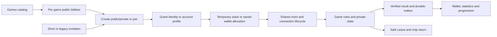

# Shared game adapters

Implemented locally on 4 November 2026. Blackjack is the first registered game. Other catalog games remain coming soon until their engines, views and acceptance checks exist.

## One table flow



Public/private visibility is independent of funding. A private table can be played alone if its rules allow one player. Guests continue to play without accounts; temporary results never create saved chips, XP or account statistics.

| Shared platform owns | Each game adapter owns |
| --- | --- |
| Game catalog, public browser, creation dialog and invitation entry | Engine state, rules and legal actions |
| Profile/guest identity and saved-wallet choice | Capacity, minimum players, guest stack and buy-in increments |
| Membership, connection tickets, controlling tab and reconnect | Joining policy and safe points to release seats |
| Command size/rate limits and authenticated player ownership | Command schema, stale-action rules and receipt creation |
| Versioned game envelopes, chat, header and Leave controls | Public snapshot schema and private-information projection |
| Durable room writes and alarms | Decisions, deadlines and next-alarm calculation |
| Wallet command delivery, receipt validation, retries and returns | Stack activation, wager accounting and settlement conversion |
| Existing account statistics and XP/reward infrastructure | Trusted game facts, detailed statistics and achievements |

## Server boundary

[`GameRoomAdapter<R>`](apps/server/src/games/contracts.ts) wraps a game's private room state. Its `HostedRoom` base contains transport, membership and wallet metadata; it has no cards, hands, betting streets or prescribed round identifier.

- `create` and `restore` construct and validate durable state, including schema/invariants. Restoration must preserve corrupt or unsupported storage by failing closed, rather than resetting it.
- `players`, `lobbyPhase` and `join` expose only identities and public discovery status. The adapter enforces mid-round joining rules.
- `snapshot` projects the authenticated player's public state. Never return the private engine, shoe or unrevealed draws.
- `parseCommand` and `apply` validate game actions, revisions, round identity, legal turns and duplicate command receipts. The shared host verifies the connection and player ID before applying them.
- `expire`, `collectSeats` and `nextAlarm` handle game deadlines, disconnected reservations and safe seat removal. Include pending wallet retries in alarm scheduling. Increment revisions for state changes. Keep committed wagers and pending returns alive after Leave until they finish safely.
- `fund` queues allocation/activation; `flushWallet` delegates delivery to the shared wallet module with a game-specific stack activation hook.

[`GameAdapterRegistry`](apps/server/src/games/registry.ts) validates registrations and routes from persisted `gameId` and `adapterVersion`. Only a registered game marked available in the catalog accepts new tables. A registered game can still restore and finish existing rooms after it is disabled for new entry. Unknown games and incompatible versions fail closed. Supporting a future version upgrade requires an explicit tested storage/engine migration; changing a version number alone is insufficient.

[`blackjackRoomAdapter`](apps/server/src/games/blackjack.ts) wraps the existing engine, storage and settlement functions. Blackjack-specific code remains in `roomState.ts`, `roomStorage.ts` and `roomWallet.ts`; those files are not templates for the shared host.

## Browser boundary

[`GameClientAdapter<S,A>`](packages/protocol/src/tablePlatform.ts) supplies a snapshot schema, identity selectors, entry rules and a command encoder. [`createTableClient`](apps/web/src/onlineClient.ts) supplies tickets, account renewal, reconnect, controller ownership, acknowledgements and chat without knowing a game's actions or round shape.

[`GameHub`](apps/web/src/GameHub.tsx) browses the selected game. [`gameEntries`](apps/web/src/gameEntries.ts) connects the shared creation dialog to its codec. Invitations first fetch strictly bounded public entry metadata, then select a compatible view in `App.tsx`; they do not assume Blackjack. [`GameRoomEntry`](apps/web/src/GameRoomEntry.tsx) provides join, resume, guest/profile identity, funding and exit navigation for any typed game view. [`TableHeader` and `TableToolbar`](apps/web/src/TableChrome.tsx) reuse chat, invitation sharing, profile and visible Leave controls; game-specific menus and decision labels are supplied by the view.

## Routes and wire format

| Route | Purpose |
| --- | --- |
| `#/games/<gameId>` | Shared lobby browser for that game |
| `POST /api/v1/games/<gameId>/rooms` | Create using the registered adapter |
| `GET /api/v1/games/<gameId>/lobbies` | Public summaries for that game only |
| `GET /api/v1/rooms/<roomId>/info` | Game/version, entry rules and visibility; no player, wallet, card or credential data |
| Existing `/rooms/<roomId>/join`, `/resume`, `/ticket`, `/socket` | Common lifecycle routed by authoritative stored metadata |

Creation derives the game from the route and replaces any client-supplied internal game header. Account entry IDs are scoped by game and account. Existing Blackjack entry IDs retain their previous derivation.

Clients negotiate `usual-game-adapter-v1` alongside the existing authenticated socket protocols. Actions travel as:

```json
{"type":"game-command","protocol":1,"gameId":"blackjack","adapterVersion":1,"command":{"id":"command UUID","playerId":"seat ID","action":{"type":"Stand"}}}
```

The inner command is illustrative; its game codec supplies all required revision, round and action fields. Snapshots use `type: "game-snapshot"` with the same protocol/game/version discriminator and the game-specific `snapshot`. Wrong-game/version commands are rejected before the reducer. Non-Blackjack connections require the capability. Existing Blackjack clients retain legacy commands/snapshots during rollout.

## Wallet and result rules

[`tableWallet.ts`](apps/server/src/tableWallet.ts) owns the durable outbox, operation IDs, account/game/session validation, exact acknowledgement checks, timeout/backoff and persist-before-next-delivery ordering. Save game state and its queued financial operations together **before** sending them to the backend. A timeout or malformed acknowledgement is not proof that a debit failed; retain and retry the same operation. Propagate local save failures after a remote commit so reload replays the persisted command safely.

All shared wallet amounts are integer hundredths of a virtual chip. Each game owns its explicit conversion and exact payout constraints. Blackjack retains its half-chip engine and physical shoe unchanged. A wallet integration test delivers a non-Blackjack string-round result with a 0.95-chip gain and returns the exact hundredths, without Blackjack conversion.

The common queue does not calculate wagers, supply fair randomness, seal a game result or prove game invariants. A new saved-chip adapter must implement and test those responsibilities before enabling saved funding. Its settlement IDs must be stable across retries and unique per player/round; the existing `lastRound` outbox-seat field is a numeric adapter-owned delivery cursor, not a required public round type. General statistics and existing XP use verified saved results; game-specific facts and achievement definitions need explicit schema/SQL/UI additions. Do not award one round of XP multiple times for split hands or multiple bets.

Poker needs balanced player-to-player pot transfers and an account/guest funding policy. The registry rejects the house-settlement mode for Texas Hold'em; use temporary-only funding until that backend exists. Do not turn temporary guest pots into saved account chips.

## Adding the next game

1. Define its pure engine, injected randomness/time, durable state schema and private/public projection. Choose capacity, minimum players, guest stack, precise chip units and funding mode.
2. Implement `GameRoomAdapter<YourRoom>` and register `hostGame(yourAdapter)` in the server registry. Cover stale/replayed commands, own-seat enforcement, join timing, controller changes, disconnect/expiry, alarms, restoration and last-player cleanup.
3. Implement the typed browser codec, register creation in `gameEntries`, and register its compatible room view in `App.tsx`. Use `GameRoomEntry` and the shared chrome. Keep the game renderer responsible for its layout, decisions and animations.
4. For saved play, implement trusted allocation/activation, wager/settlement invariants, durable result delivery, safe Leave/expiry returns and exact canonical conversion. Add detailed facts/statistics and that game's achievement definitions. Test database rollback, retry/replay, account isolation and reconciliation.
5. Run unit/runtime conformance and production-subpath browser acceptance for guest and saved modes, public/private discovery, direct invitation, reload, chat and Leave. Keep credentials/private state out of projections. The non-card fixtures in `gameAdapters.test.ts` and `onlineClient.test.ts` demonstrate independent round keys and capacity; they are never registered in production.
6. Mark the catalog entry available only after the complete flow passes. Deploy Worker before Pages.

## Compatibility and rollout

This adapter refactor adds no SQL migration, credential, Durable Object binding or migration tag. Existing Blackjack room schemas 2/3/4, half-chip units, shoe, account ownership, wallet ledger and both invitation formats remain supported. Optional adapter metadata identifies new rooms. Missing legacy metadata means Blackjack version 1; invalid explicit metadata is rejected.

Deploy the Worker first, then GitHub Pages. The read-only Pages API gate now requires `gameAdapterProtocol: 1`; an older Worker cannot serve the new generic creation/metadata flow. Previous account-reward SQL requirements still apply independently. No hosted deployment or database change was performed for this work.
